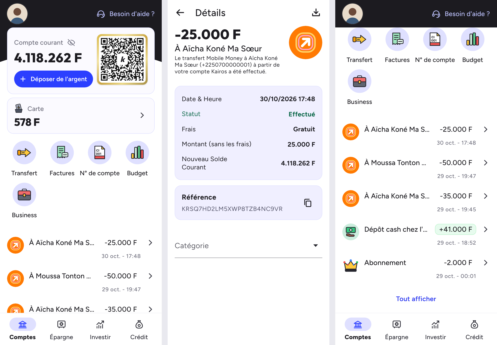

# Kairos – application mobile de banque en ligne (démo)

Application web mobile (PWA) qui reproduit l'interface d'une banque en ligne :



- **Accueil (Comptes)** : en-tête sombre avec avatar et « Besoin d'aide ? », carte du
  compte courant (solde, bouton « Déposer de l'argent », QR code doré), tuile « Carte »,
  actions rapides (Transfert, Factures, N° de compte, Budget, Business), 5 dernières
  opérations et lien « Tout afficher ». L'en-tête reste fixé en haut au défilement.
- **Détails d'une opération** : montant, bénéficiaire, description, date et heure, statut,
  frais, montant, nouveau solde, référence (copiable) et choix d'une catégorie.
- **Toutes les opérations** : regroupées par jour, avec filtres Tout / Entrées / Sorties.
- **Carte** : carte virtuelle, solde, gel / dégel.
- **Épargne, Investir, Crédit** : onglets de la barre du bas (écrans « bientôt disponible »).
- Masquage du solde (icône œil), feuilles « Déposer de l'argent », « Mon QR code »,
  « N° de compte ». Les préférences sont gardées dans le navigateur (localStorage).

Toutes les données (noms, numéros, références, montants) sont **fictives**.

## Lancer l'application

Aucune installation n'est nécessaire (HTML/CSS/JavaScript, sans dépendance).

- **Le plus simple** : ouvrir `index.html` dans un navigateur.
- **Avec un petit serveur** (active aussi le mode hors ligne) :

  ```bash
  cd app-banque
  python3 -m http.server 8000
  ```

  puis ouvrir <http://localhost:8000>. Sur ordinateur, l'app s'affiche au format téléphone ;
  utilisez le mode « appareil mobile » des outils de développement pour l'aperçu exact.

- **Sur un téléphone** : héberger le dossier (GitHub Pages, Netlify, etc.), ouvrir l'adresse
  dans Chrome ou Safari puis « Ajouter à l'écran d'accueil » : l'app s'ouvre en plein écran
  comme une application installée.

## Modifier le contenu

Tout le contenu est dans [`js/data.js`](js/data.js) :

- `account.balance` : solde du compte courant ;
- `card.balance` : solde de la carte ;
- `transactions` : la liste des opérations (la plus récente en premier). Types disponibles :
  `mobile_transfer`, `cash_deposit`, `subscription`, `bill`, `account_transfer_in`,
  `card_topup`. Le « Nouveau Solde Courant » de chaque opération est recalculé
  automatiquement à partir du solde actuel ;
- `user.avatar` : chemin d'une photo (par ex. `img/avatar.jpg`) pour remplacer l'avatar.

## Structure

```
app-banque/
├── index.html            point d'entrée
├── manifest.webmanifest  installation sur l'écran d'accueil (PWA)
├── sw.js                 cache hors ligne
├── css/styles.css        styles
├── js/data.js            données de démonstration
├── js/icons.js           icônes SVG
├── js/app.js             écrans, navigation, interactions
├── js/vendor/qrcode.js   générateur de QR code (Kazuhiko Arase, licence MIT)
├── fonts/                polices Figtree et Outfit (licence SIL OFL)
└── img/                  icônes de l'application
```
